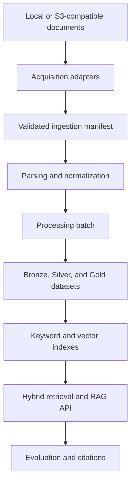

# Enterprise Document Intelligence and Hybrid RAG

A cost-safe portfolio implementation of an enterprise document-processing and
retrieval-augmented generation platform designed for AWS and Databricks
workloads.

**Development version:** `0.1.0.dev0`

## Overview

This project demonstrates the engineering foundations of an enterprise
document-intelligence platform. It is being developed incrementally from a
fully local ingestion and processing pipeline toward governed lakehouse
datasets, hybrid retrieval, grounded generation, and measurable RAG quality.

The current implementation discovers local enterprise documents, generates
stable document and version identities, preserves authorization metadata,
writes validated ingestion manifests, parses TXT, CSV, PDF, and DOCX documents
into normalized records, and persists recoverable processing-batch artifacts.

Only synthetic documents are included. No customer, employer, or confidential
data is used.

## Current capabilities

The ingestion foundation currently provides:

- Typed Pydantic contracts for document metadata and source locations
- Local discovery of PDF, DOCX, CSV, TXT, JPEG, and PNG files
- Streaming SHA-256 calculation without loading complete files into memory
- Stable document identities scoped by source
- Content-dependent document version identities
- UTC-aware creation and modification timestamps
- Access-group metadata for future retrieval authorization
- Deterministic document ordering
- Recoverable per-document ingestion failures
- Validated ingestion manifests
- Safe JSON manifest persistence
- Explicit overwrite protection
- Synthetic policy and document-register examples

The document-processing foundation currently provides:

- Immutable normalized document and segment contracts
- Deterministic plain-text parsing
- UTF-8 and UTF-8 BOM handling
- Unicode NFC and line-ending normalization
- Paragraph extraction with source-line ranges
- Deterministic CSV parsing
- CSV header validation and stable table-row segments
- Page-aware PDF text extraction
- Stable PDF page-segment identities and page locations
- Explicit detection of PDFs requiring OCR
- Ordered DOCX paragraph and table extraction
- Preservation of DOCX paragraph styles and table-row locations
- Stable DOCX segment identities
- Typed parser protocols and a deterministic parser registry
- Format routing for TXT, CSV, PDF, and DOCX documents
- Recoverable document-level processing failures
- Stable processing-batch identities
- Validated JSON processing-batch persistence
- Atomic overwrite behavior
- End-to-end `ingest-local` and `process-local` CLI commands
- End-to-end PDF and DOCX pipeline integration testing
- Strict static analysis, security scanning, and automated tests

OCR execution, cloud adapters, lakehouse datasets, retrieval, and generation
are planned but are not yet implemented.

## Architecture direction



The local and cloud adapters will share typed ingestion and processing
boundaries. This allows the project to develop and test its core behavior
without requiring paid cloud infrastructure.

## Zero-cost development policy

This project has a strict zero-cost cloud requirement.

- Local development uses free and open-source tools.
- Synthetic documents are used exclusively.
- Databricks work must remain within Free Edition capabilities.
- AWS experiments must remain within an available free plan or local emulator.
- No paid account upgrade is required.
- No cloud resource may be created without an explicit cost review.
- Credentials, account identifiers, tokens, and secrets must never enter Git.
- Generated artifacts are excluded from version control.

Databricks Free Edition does not support every production deployment pattern.
Where a direct cloud integration is unavailable, the project uses compatible
local adapters while documenting the equivalent production architecture.

## Requirements

- Python 3.11 or 3.12
- Git
- PowerShell, Bash, or another supported terminal

No AWS or Databricks account is required for the current phase.

## Installation

Create and activate a virtual environment, then install the project with its
development dependencies:

```bash
python -m venv .venv
python -m pip install --upgrade pip
python -m pip install -e ".[dev]"
```

On Windows PowerShell, activate the environment with:

```powershell
.\.venv\Scripts\Activate.ps1
```

## Local ingestion and processing demonstration

The repository includes two synthetic enterprise documents:

- `data/synthetic/policies/access-control-policy.txt`
- `data/synthetic/registers/document-register.csv`

The automated test suite additionally generates synthetic PDF and DOCX
documents at runtime to verify their complete ingestion and processing path
without storing generated binary fixtures in Git.

### Ingest the documents

Generate a validated ingestion manifest:

```bash
document-rag ingest-local data/synthetic \
  --output artifacts/synthetic-ingestion-manifest.json \
  --source-id northstar-synthetic-documents \
  --access-group engineering \
  --access-group security \
  --overwrite
```

PowerShell equivalent:

```powershell
document-rag ingest-local `
    data\synthetic `
    --output artifacts\synthetic-ingestion-manifest.json `
    --source-id northstar-synthetic-documents `
    --access-group engineering `
    --access-group security `
    --overwrite
```

Expected summary:

```text
Source: northstar-synthetic-documents
Documents: 2
Failures: 0
```

The ingestion manifest contains:

- Manifest identity
- Source identity and source-system type
- Document and version identities
- Relative source URIs
- Document formats and media types
- File sizes and SHA-256 content hashes
- UTC timestamps
- Access groups
- Ingestion status
- Recoverable ingestion failures

### Process the ingestion manifest

Convert the acquired documents into normalized records:

```bash
document-rag process-local data/synthetic \
  --manifest artifacts/synthetic-ingestion-manifest.json \
  --output artifacts/synthetic-processing-batch.json \
  --overwrite
```

PowerShell equivalent:

```powershell
document-rag process-local `
    data\synthetic `
    --manifest artifacts\synthetic-ingestion-manifest.json `
    --output artifacts\synthetic-processing-batch.json `
    --overwrite
```

Expected summary:

```text
Documents: 2
Processing failures: 0
Ingestion failures: 0
```

With the repository's current TXT and CSV fixtures, the processing batch
contains:

```text
Documents: 2
Segments: 23
access-control-policy.txt: 18 segments
document-register.csv: 5 segments
```

The processing artifact preserves:

- The originating manifest identity
- Document and version traceability
- Source URIs and authorization groups
- Parser names and versions
- UTC processing timestamps
- Stable segment identities and ordinals
- Plain-text source-line ranges
- CSV record locations and attributes
- PDF page numbers and extraction metadata
- DOCX block, paragraph, table, and row locations
- Recoverable processing failures
- Upstream ingestion-failure counts

Validate the generated processing artifact directly:

```bash
python -c "from pathlib import Path; from enterprise_document_rag.processing import read_processing_batch; b = read_processing_batch(Path('artifacts/synthetic-processing-batch.json')); print(f'Batch: {b.batch_id}'); print(f'Documents: {b.document_count}'); print(f'Failures: {b.failure_count}'); print(f'Segments: {sum(len(d.segments) for d in b.documents)}')"
```

Existing manifests and processing batches are not overwritten by default. Use
`--overwrite` only when replacement is intentional.

Generated files beneath `artifacts/` are ignored by Git.

## Development validation

Run the complete local quality gate:

```bash
python -m ruff check .
python -m ruff format --check .
python -m mypy
python -m pytest --cov --cov-report=term-missing
python -m bandit -q -r src
python -m build
```

The test suite includes a complete synthetic PDF and DOCX integration path
covering local discovery, metadata generation, manifest construction, parser
selection, normalized extraction, and recoverable batch execution.

The CI workflow runs on Windows and Ubuntu with Python 3.11 and 3.12. It checks
linting, formatting, strict typing, tests, coverage, security scanning, and
distribution builds.

## Planned phases

### Phase 1 - Ingestion foundation

Completed:

- Typed document and source contracts
- Deterministic local discovery
- Stable document and version identities
- Validated ingestion manifests
- JSON persistence
- Local ingestion CLI
- Synthetic enterprise documents

### Phase 2 - Document processing

Implemented:

- Normalized document and segment contracts
- Deterministic TXT extraction
- Deterministic CSV extraction
- Page-aware PDF text extraction
- Ordered DOCX paragraph and table extraction
- Typed parser registry for TXT, CSV, PDF, and DOCX
- Recoverable batch processing
- Stable processing-batch identities
- Validated JSON batch persistence
- Local processing CLI
- End-to-end PDF and DOCX pipeline integration testing

Remaining Phase 2 work:

- OCR fallback design and adapter boundary
- Chunking with page and source traceability
- Duplicate-content handling across sources
- Expanded processing demonstration fixtures

### Phase 3 - Lakehouse representation

- Bronze, Silver, and Gold schemas
- Delta-compatible local development
- Databricks notebook and job examples
- Incremental processing semantics
- Data-quality evidence

### Phase 4 - Retrieval

- Keyword retrieval baseline
- Vector retrieval
- Metadata and access-group filtering
- Hybrid retrieval
- Optional reranking
- Retrieval evaluation using Recall@K and MRR

### Phase 5 - Grounded RAG

- FastAPI query service
- Evidence-based answers
- Document and page citations
- Insufficient-evidence refusal
- Groundedness and citation evaluation
- Operational logging and monitoring

### Phase 6 - Cloud adapters

- AWS S3-compatible source adapter
- Least-privilege IAM design
- Databricks ingestion adapter
- Secrets-management documentation
- Cost controls and deployment safeguards

## Engineering principles

- Preserve source traceability.
- Keep document identities stable across content changes.
- Treat each content change as a distinct document version.
- Enforce authorization metadata before retrieval.
- Isolate cloud-specific behavior behind typed interfaces.
- Measure retrieval independently from generation.
- Prefer deterministic processing where possible.
- Record recoverable failures instead of silently dropping documents.
- Reject silent data loss and uncontrolled overwrites.
- Keep the complete portfolio workflow reproducible without paid services.

## Project status

Phase 1 is complete and merged. Phase 2 now provides deterministic TXT, CSV,
PDF, and DOCX processing; typed parser selection; recoverable batch execution;
validated processing artifacts; and end-to-end local and integration-tested
processing workflows.

OCR, chunking, cross-source duplicate handling, lakehouse representation,
retrieval, grounded generation, and cloud adapters remain planned work.
